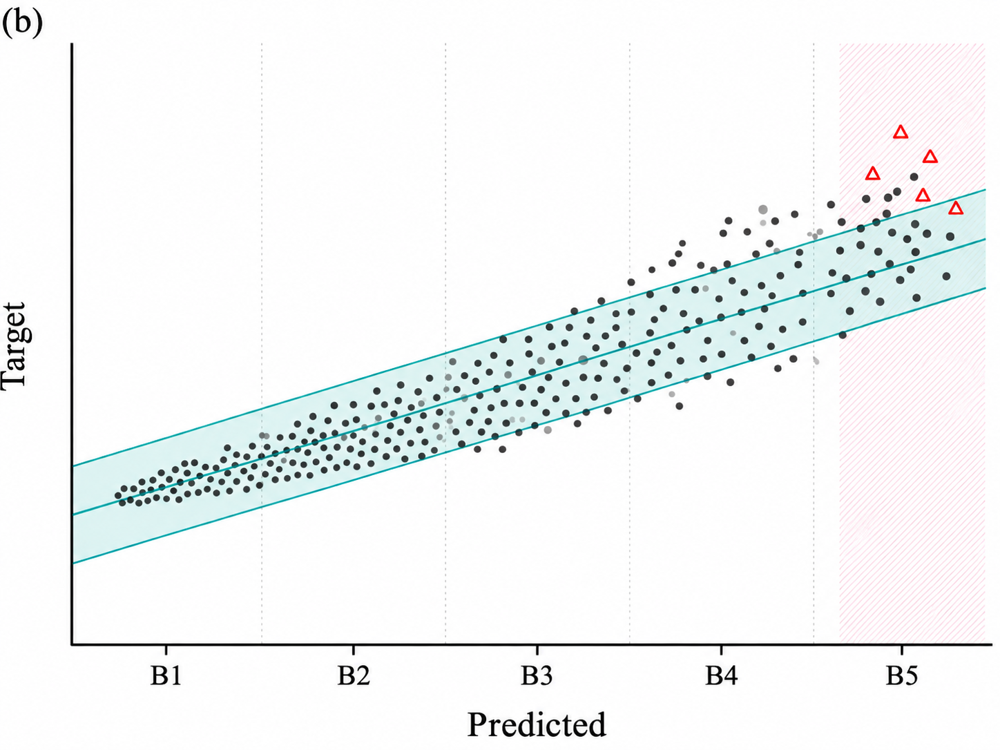
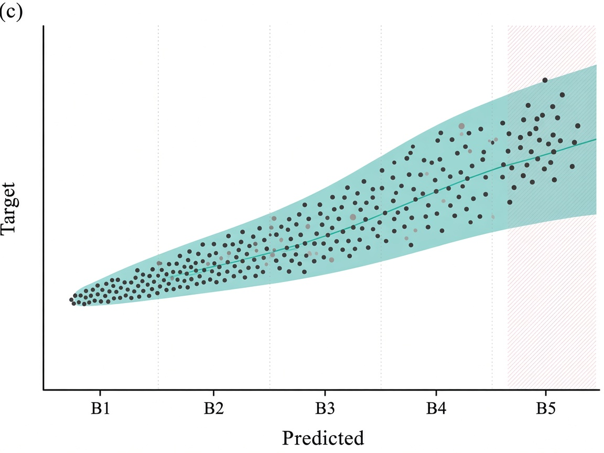
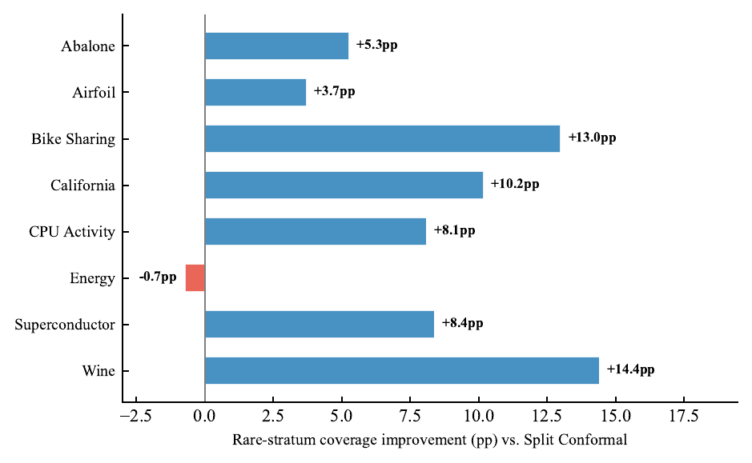
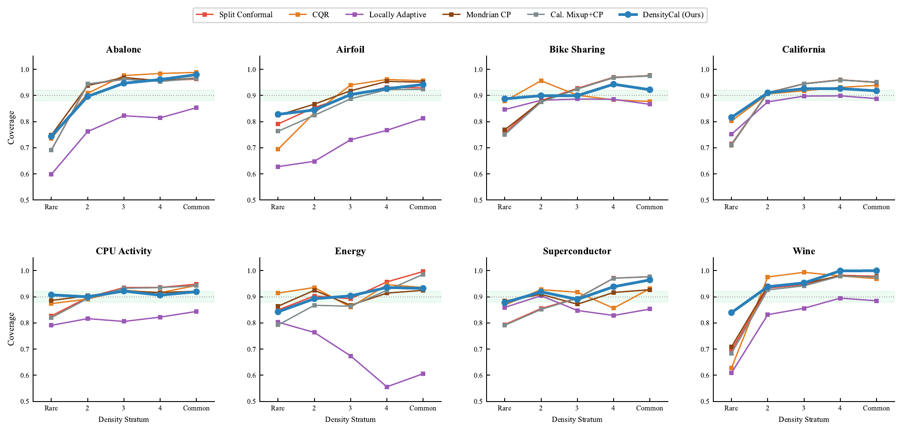

# DensityCal

**A split conformal interval can look well calibrated on average and still miss the rate where predictions are large.**

DensityCal bins the predicted range, takes a local residual quantile in each bin, blends toward the global quantile when a bin is data-poor, and **never** issues a half-width below the global one. The resulting interval nests the split-conformal interval, so finite-sample *marginal* coverage is inherited. Extra width is spent only where the local spread is larger.

<p align="center">
  <a href="supplement/appendix.pdf"><strong>Optional supplement (PDF)</strong></a>
  &nbsp;·&nbsp;
  <a href="#the-picture"><strong>The picture</strong></a>
  &nbsp;·&nbsp;
  <a href="#coverage-in-the-sparsest-bin"><strong>Sparsest-bin coverage</strong></a>
  &nbsp;·&nbsp;
  <a href="#quick-start"><strong>Quick start</strong></a>
  &nbsp;·&nbsp;
  <a href="#layout"><strong>Layout</strong></a>
</p>

---

## The picture

One global residual quantile is asked to serve residual laws that fan out. A local band with a one-sided floor widens only where that fan is real.

<p align="center">
  
  
  
</p>
<p align="center"><em>Left to right:</em> residual fan-out along the predicted value; a single global band; the floored local band.</p>

<p align="center">
  
</p>
<p align="center"><em>Bins on the predicted value, occupancy blend, one-sided floor, test-time lookup.</em></p>

---

## Coverage in the sparsest bin

Bins are occupancy strata on the predicted value, not rare-target strata. Relative to split conformal, the sparsest predicted bin is where the global quantile is most often short.

<p align="center">
  
</p>
<p align="center"><em>Coverage change in the sparsest predicted-value bin versus split conformal.</em></p>

<p align="center">
  
</p>
<p align="center"><em>Per-dataset coverage across five occupancy strata of the predicted value. The dashed line is the nominal rate.</em></p>

---

## Optional supplementary material

[`supplement/appendix.pdf`](supplement/appendix.pdf) is extra. The submitted PDF is self-contained: it already carries the identity, the one-sided floor, the algorithm, Theorems 1–3 with proofs, the coverage and width tables, the per-dataset grids, the paired tests, the interpolation ablation, and the sparsest-bin figure.

What remains in the supplement is the longer side algebra (width inflation and the local-quantile expansion) and a reprint of tables that already live in the main PDF. A reviewer who never opens this file is not missing a load-bearing claim.

---

## Quick start

Python 3.9+.

```bash
pip install -r requirements.txt
python scripts/smoke_test.py
```

Full grid (OpenML / network on first download):

```bash
python scripts/run_experiments.py --config configs/default.yaml --output-dir ./outputs
```

---

## Layout

```
src/conformal/     split / local / blended / floored intervals
src/methods/       wrappers used by the runner
src/data/          OpenML loaders
src/evaluation/    coverage, width, CovGap
scripts/           smoke test and experiment driver
configs/           default grid
docs/figures/      manuscript figures used in this README
supplement/        optional appendix PDF
```
