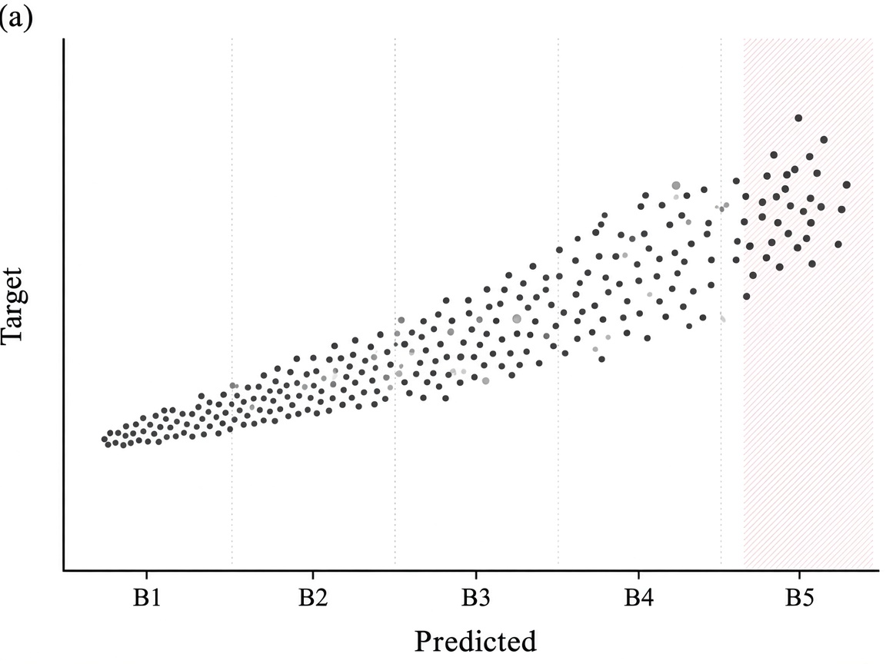

# DensityCal

**A split conformal interval can look well calibrated on average and still miss the rate where predictions are large.**

DensityCal bins the predicted range, takes a local residual quantile in each bin, blends toward the global quantile when a bin is data-poor, and **never** issues a half-width below the global one. The resulting interval nests the split-conformal interval, so finite-sample *marginal* coverage is inherited. Extra width is spent only where the local spread is larger.

> **Optional supplementary material** — [`supplement/appendix.pdf`](supplement/appendix.pdf)
>
> Extended proofs, occupancy and paired-run diagnostics, per-dataset width grids, and extra figures. The submitted PDF is self-contained; this file is extra.

## Residual fan-out along the predicted value

One global residual quantile is asked to serve residual laws that fan out. A local band with a one-sided floor widens only where that fan is real.

<p align="center">
  
  
  
</p>
<p align="center"><em>Left to right:</em> residual fan-out; a single global band; the floored local band.</p>

<p align="center">
  
</p>
<p align="center"><em>Bins on the predicted value, occupancy blend, one-sided floor, test-time lookup.</em></p>

## Quick start

Python 3.9+.

```bash
pip install -r requirements.txt
python scripts/smoke_test.py
```

Full grid (OpenML / network on first download):

```bash
python scripts/run_experiments.py --config configs/default.yaml --output-dir ./outputs
```

## Layout

```
src/conformal/     split / local / blended / floored intervals
src/methods/      wrappers used by the runner
src/data/          OpenML loaders
src/evaluation/    coverage, width, CovGap
scripts/           smoke test and experiment driver
configs/           default grid
docs/figures/      manuscript figures used in this README
supplement/        optional appendix PDF
```
