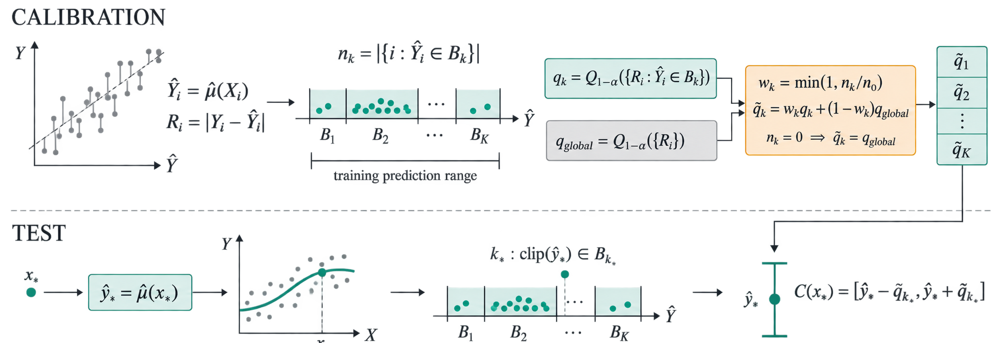

# DensityCal

Predicted-value-stratified conformal prediction with a **one-sided floor**.

A split conformal interval can look well calibrated on average and still miss the nominal rate on high-prediction strata, because one global residual quantile is asked to serve residual laws that fan out along the predicted value. DensityCal bins that predicted range, takes a local residual quantile in each bin, blends toward the global quantile when a bin is data-poor, and **never** issues a half-width below the global one. The resulting interval nests the split-conformal interval, so finite-sample *marginal* coverage is inherited; extra width is spent only where the local spread is larger.

<p align="center">
  
  
  
</p>
<p align="center"><em>Left to right: residual fan-out; a single global band; the floored local band.</em></p>

<p align="center">
  
</p>
<p align="center"><em>Bins on the predicted value, occupancy blend, one-sided floor, test-time lookup.</em></p>

## Setup

Python 3.9+.

```
pip install -r requirements.txt
```

## Quick start

Smoke (tiny synthetic split):

```
python scripts/smoke_test.py
```

Full grid (OpenML / network on first download):

```
python scripts/run_experiments.py --config configs/default.yaml --output-dir ./outputs
```

## Optional supplementary technical material

`supplement/appendix.pdf` has extended proofs, occupancy and paired-run diagnostics, per-dataset width grids, and extra figures.

That file is **optional**. It is not required to evaluate the claims in the submitted PDF.

## What this tree is

The proposed method plus published baselines. No author names, emails, or institutional paths.
